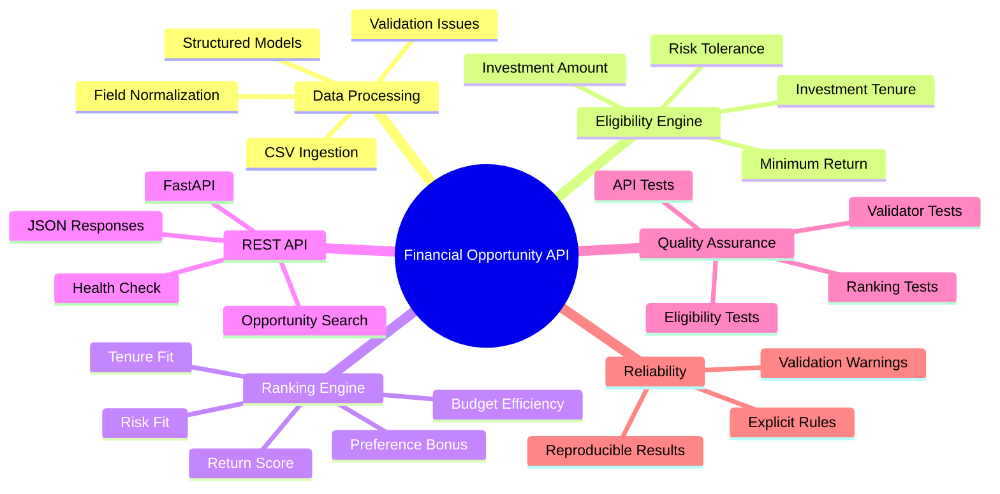
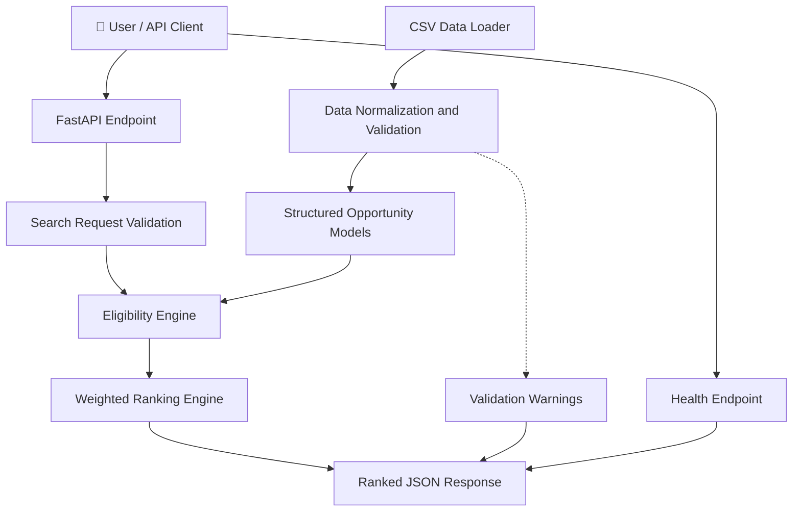
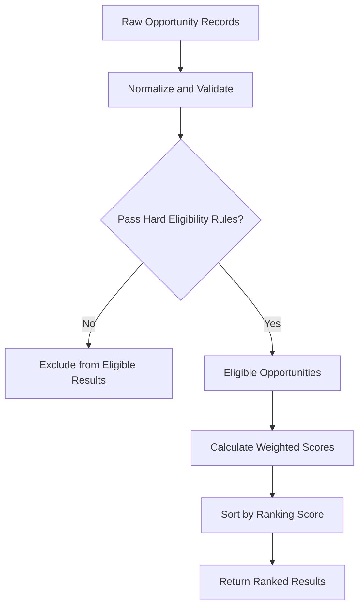
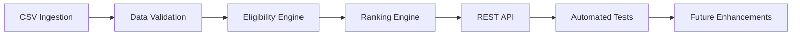

# 💰 Financial Opportunity Processing & Eligibility API

### A Data-Driven Investment Opportunity Screening and Ranking Service

<p align="center">
  
  
  
  
  
</p>

---

## 🌟 Overview

The **Financial Opportunity Processing & Eligibility API** is a Python backend application built with FastAPI that processes financial opportunity data, evaluates eligibility against user-defined investment criteria, and ranks qualifying opportunities using a weighted scoring system.

The service transforms inconsistent CSV records into structured data, validates and normalizes financial fields, applies eligibility rules, and returns ranked results through a REST API.

The project emphasizes **data quality, transparent business rules, modular architecture, explainable ranking, and automated testing**.

### ✨ Key Features

- 📂 **CSV ingestion** — Loads financial opportunity records into the application.
- 🧹 **Data normalization** — Handles inconsistent currency, tenure, risk, and return representations.
- ✅ **Eligibility evaluation** — Checks opportunities against investment amount, risk tolerance, tenure, and minimum-return requirements.
- 📊 **Weighted ranking** — Scores eligible opportunities using configurable business criteria.
- ⚖️ **Preference-aware recommendations** — Uses category and liquidity preferences as ranking factors.
- ⚠️ **Validation transparency** — Reports parsing problems through `validation_warnings` rather than silently discarding problematic records.
- 🚀 **REST API** — Exposes opportunity search and health-check endpoints.
- 🧪 **Layered automated tests** — Tests validation, eligibility, ranking, and HTTP behavior independently.

---

## 🧠 Project Mind Map



---

## 🏗️ System Architecture

The application separates data ingestion, validation, eligibility evaluation, ranking, and HTTP request handling.



### 🔍 Request Processing Flow

1. The client submits investment preferences to the search endpoint.
2. FastAPI validates the incoming request.
3. The data loader reads the opportunity dataset.
4. The validator normalizes inconsistent fields and records validation issues.
5. The eligibility engine determines which opportunities satisfy the hard requirements.
6. The ranking engine calculates scores for eligible opportunities.
7. The API returns the ranked results and applicable validation warnings.

*The diagram describes the intended processing flow. Exact execution order and response fields should be confirmed against the current implementation.*

---

## ⚙️ Eligibility vs. Ranking

One of the central design decisions is the separation of **hard eligibility requirements** from **soft ranking preferences**.



### Hard eligibility requirements

The eligibility engine evaluates the user's mandatory investment criteria, such as:

- Investment amount and budget constraints
- Risk compatibility
- Investment tenure
- Minimum expected return, when requested

Opportunities with an unparseable or `Variable` return are excluded when a minimum return is required, rather than being assumed to satisfy the requirement.

### Soft ranking preferences

Category and liquidity are treated as preferences that influence ranking instead of automatically disqualifying an opportunity.

This distinction allows the service to return qualifying opportunities while prioritizing those that better match the user's preferences.

---

## 📈 Weighted Ranking Model

The ranking engine combines multiple factors into an overall score.

| Ranking factor | Weight |
|---|---:|
| Risk fit | 30% |
| Tenure fit | 25% |
| Return score | 25% |
| Budget efficiency | 10% |
| Preference bonus | 10% |
| **Total** | **100%** |

Conceptually, the overall score is:

\[
\begin{aligned}
S ={}& 0.30R + 0.25T + 0.25Y\\
    &+ 0.10B + 0.10P
\end{aligned}
\]

Where:

- \(R\) = risk-fit score
- \(T\) = tenure-fit score
- \(Y\) = return score
- \(B\) = budget-efficiency score
- \(P\) = preference-bonus score

The individual score calculations, normalization ranges, and tie-breaking rules are defined by the implementation. The formula above represents the weighted combination of the five factors.

---

## 🛠️ Technology Stack

| Technology | Purpose |
|---|---|
| Python 3.10+ | Core programming language |
| FastAPI | REST API framework |
| Pydantic | Request and data-model validation |
| Pandas | Data processing, if used in the implementation |
| CSV | Opportunity dataset |
| Pytest | Automated testing |
| Uvicorn | ASGI application server |

---

## 📁 Project Structure

```text
Harinath_Python_Assignment/
│
├── README.md
├── TECHNICAL_NOTE.md
├── requirements.txt
│
├── data/
│   ├── opportunities.csv
│   ├── sample_queries.csv
│   └── data_schema.json
│
├── src/
│   ├── models.py
│   ├── data_loader.py
│   ├── validator.py
│   ├── eligibility.py
│   ├── ranking.py
│   ├── api.py
│   └── main.py
│
├── tests/
│   ├── test_validator.py
│   ├── test_eligibility.py
│   ├── test_ranking.py
│   └── test_api.py
│
└── sample_output/
    └── Saved request and response examples
```

### Module Responsibilities

| Module | Responsibility |
|---|---|
| `models.py` | Defines structured opportunity and search-request models |
| `data_loader.py` | Loads the opportunity dataset |
| `validator.py` | Normalizes fields and records validation issues |
| `eligibility.py` | Implements hard eligibility rules |
| `ranking.py` | Calculates weighted ranking scores |
| `api.py` | Defines HTTP endpoints and connects application components |
| `main.py` | Starts the application |
| `tests/` | Verifies business logic and API behavior |

---

## 🚀 Getting Started

### Prerequisites

- Python 3.10 or newer
- pip
- Terminal or command prompt

### 1. Extract and open the project

Extract `Harinath_Python_Assignment.zip`, then navigate into the extracted project directory.

```bash
cd path/to/Harinath_Python_Assignment
```

Replace the example path with your actual directory.

### 2. Create a virtual environment

On macOS or Linux:

```bash
python3 -m venv venv
source venv/bin/activate
```

On Windows:

```powershell
python -m venv venv
venv\Scripts\activate
```

### 3. Install dependencies

```bash
python -m pip install -r requirements.txt
```

### 4. Start the API

```bash
python -m src.main
```

The application should start at:

- **Base URL:** http://localhost:8000
- **Swagger UI:** http://localhost:8000/docs
- **ReDoc:** http://localhost:8000/redoc

For development with automatic reload:

```bash
uvicorn src.api:app --reload
```

Use the entry point that matches your application's configuration.

---

## 🔎 API Usage

### Search opportunities

**Endpoint:** `POST /opportunities/search`

**Example request:**

```json
{
  "investment_amount": 200000,
  "risk": "Moderate",
  "tenure_months": 24,
  "minimum_return": 9,
  "category": "Debt",
  "liquidity": "Medium"
}
```

**Example cURL command:**

```bash
curl -X POST "http://localhost:8000/opportunities/search" \
  -H "Content-Type: application/json" \
  -d '{
    "investment_amount": 200000,
    "risk": "Moderate",
    "tenure_months": 24,
    "minimum_return": 9,
    "category": "Debt",
    "liquidity": "Medium"
  }'
```

The response contains the search results and relevant validation information according to the implemented response schema.

A saved request and response for this example are available in `sample_output/`.

### Health check

**Endpoint:** `GET /health`

Use the health endpoint to check whether the service is running and inspect the number of opportunities loaded.

```bash
curl "http://localhost:8000/health"
```

For the exact response structure and interactive testing, open `/docs` after starting the server.

---

## 🧪 Running the Tests

Run the complete test suite:

```bash
pytest tests/ -v
```

### Test coverage by module

| Test file | Purpose |
|---|---|
| `test_validator.py` | Parsing, normalization, and validation behavior |
| `test_eligibility.py` | Eligibility business rules |
| `test_ranking.py` | Ranking scores and ordering |
| `test_api.py` | Endpoint responses, sample request, and error cases |

Separating the tests by layer helps isolate business-rule defects from HTTP integration issues.

---

## 💡 Important Engineering Decisions

### 1. Validation issues are explicit

Malformed fields are represented as `ValidationIssue` objects and exposed through `validation_warnings`, instead of being silently discarded.

This improves transparency and helps diagnose problems in source data.

### 2. Eligibility and ranking are separate

Hard constraints determine which opportunities qualify. Soft preferences influence the ordering of qualifying opportunities.

This makes the behavior easier to reason about and test.

### 3. Unknown returns are handled conservatively

When the user specifies a minimum return, an unparseable or `Variable` return does not automatically qualify.

This avoids treating missing or ambiguous financial information as a confirmed pass.

### 4. Business logic can be tested without HTTP

The validator, eligibility engine, and ranking engine have their own tests, allowing core behavior to be checked independently of the FastAPI server.

For additional design rationale, refer to `TECHNICAL_NOTE.md`.

---

## 🗺️ Development Roadmap



Potential future improvements:

- [ ] Add structured request and response examples to API documentation.
- [ ] Add performance benchmarks for larger datasets.
- [ ] Expand edge-case and property-based testing.
- [ ] Add configurable ranking weights.
- [ ] Introduce dataset versioning and data-quality reporting.
- [ ] Add structured logging and request tracing.
- [ ] Evaluate persistent storage if the dataset grows beyond the current CSV-based design.

These items are proposed improvements, not claims of existing functionality.

---

## 👨‍💻 Author

**Rayala Harinath**

B.Tech Computer Science & Engineering

- GitHub: [@Harinath125](https://github.com/Harinath125)
- LinkedIn: [Rayala Harinath](https://linkedin.com/in/rayala-harinath-853300303)

---

## ⚠️ Disclaimer

This project demonstrates financial data processing, eligibility evaluation, ranking logic, and REST API engineering. The output is based on the supplied dataset and implemented rules. It is not personalized financial advice or a guarantee of investment performance.

---

⭐ If you find this project useful, consider starring the repository!
