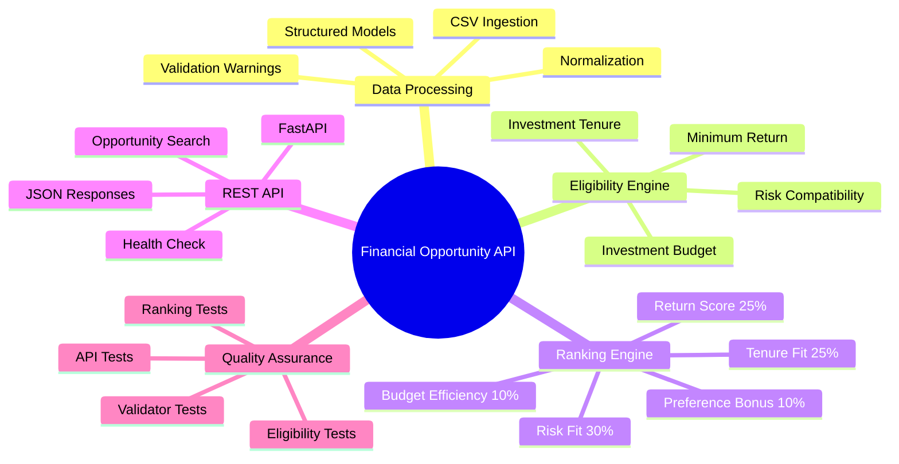
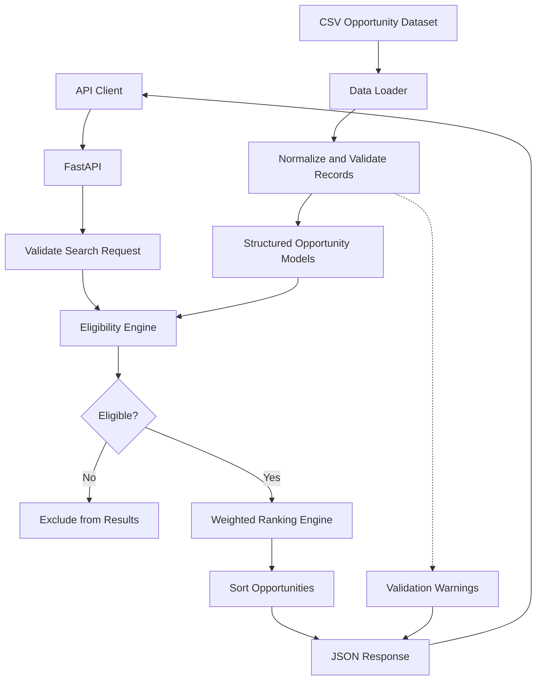
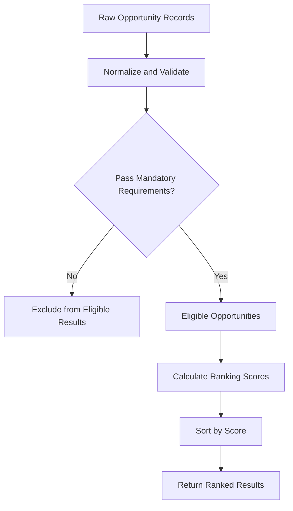

# Financial Opportunity Processing & Eligibility API 💰

### A Data-Driven Investment Opportunity Screening and Ranking Service

A Python REST API built with FastAPI that processes financial opportunity data, evaluates investment eligibility against user-defined criteria, and ranks qualifying opportunities using a transparent weighted-scoring model.

<p align="center">
  
  
  
  
  
</p>

<p align="center">
  <a href="https://github.com/Harinath125/finance_api">Source Code</a> •
  <a href="https://github.com/Harinath125/finance_api/issues">Report an Issue</a>
</p>

---

## 🚀 Overview

Financial opportunity data often contains inconsistent formats, missing values, and different representations of risk, tenure, liquidity, and returns. These inconsistencies make reliable comparison difficult.

This project addresses that challenge through a modular processing pipeline that transforms CSV records into structured opportunities, evaluates mandatory eligibility requirements, and ranks qualifying results according to user preferences.

### Key features

- **CSV ingestion:** Load financial opportunities from a structured dataset.
- **Data normalization:** Handle inconsistent currency, tenure, risk, and return representations.
- **Eligibility engine:** Evaluate budget, risk tolerance, tenure, and minimum-return requirements.
- **Weighted ranking:** Score eligible opportunities using five distinct factors.
- **Preference-aware ranking:** Incorporate category and liquidity preferences.
- **Transparent validation:** Surface malformed fields through `validation_warnings`.
- **REST API:** Expose opportunity search and health-check endpoints.
- **Automated testing:** Test validation, eligibility, ranking, and API behavior independently.

## 🧠 Project Mind Map



## 🏗️ System Architecture



### Processing workflow

1. The client submits investment criteria.
2. FastAPI validates the request.
3. The data loader reads the opportunity dataset.
4. The validator normalizes financial fields and records validation issues.
5. The eligibility engine applies mandatory requirements.
6. The ranking engine scores eligible opportunities.
7. The API returns ranked results and applicable validation warnings.

## ⚖️ Eligibility vs. Ranking

A key design decision is to separate **hard eligibility requirements** from **soft ranking preferences**.



**Hard eligibility requirements** determine whether an opportunity qualifies. These include investment amount, risk compatibility, tenure, and minimum return when specified.

**Soft preferences** influence the order of qualifying opportunities. Category and liquidity preferences contribute to ranking rather than automatically disqualifying an opportunity.

When a minimum return is required, an unparseable or `Variable` return is not assumed to satisfy that requirement.

## 📊 Weighted Ranking Model

The ranking engine combines five factors into an overall score.

| Ranking factor | Weight |
|---|---:|
| Risk fit | 30% |
| Tenure fit | 25% |
| Return score | 25% |
| Budget efficiency | 10% |
| Preference bonus | 10% |
| **Total** | **100%** |

The conceptual scoring formula is:

\[
S = 0.30R + 0.25T + 0.25Y + 0.10B + 0.10P
\]

Where:

- \(R\) = risk-fit score
- \(T\) = tenure-fit score
- \(Y\) = return score
- \(B\) = budget-efficiency score
- \(P\) = preference-bonus score

The weights describe each factor's contribution to the total score. The precise score calculations, normalization, and tie-breaking behavior are determined by the implementation.

## 🛠️ Technology Stack

| Technology | Purpose |
|---|---|
| Python | Core application logic |
| FastAPI | REST API framework |
| Pydantic | Request validation and structured models |
| CSV | Opportunity data source |
| Uvicorn | ASGI server |
| Pytest | Automated testing |

## 📂 Project Structure

```text
finance_api/
├── data/
│   ├── opportunities.csv
│   ├── sample_queries.csv
│   └── data_schema.json
├── sample_output/
├── src/
│   ├── models.py
│   ├── data_loader.py
│   ├── validator.py
│   ├── eligibility.py
│   ├── ranking.py
│   ├── api.py
│   └── main.py
├── tests/
│   ├── test_validator.py
│   ├── test_eligibility.py
│   ├── test_ranking.py
│   └── test_api.py
├── TECHNICAL_NOTE.md
├── requirements.txt
└── README.md
```

### Module responsibilities

| Module | Responsibility |
|---|---|
| `models.py` | Structured opportunity and request models |
| `data_loader.py` | Load opportunity records |
| `validator.py` | Normalize fields and surface validation issues |
| `eligibility.py` | Apply mandatory eligibility rules |
| `ranking.py` | Calculate weighted scores and rank results |
| `api.py` | Define API endpoints |
| `main.py` | Application entry point |
| `tests/` | Verify business rules and API behavior |

## ⚙️ Getting Started

### Prerequisites

- Python 3.10 or newer
- pip
- Git

### 1. Clone the repository

```bash
git clone https://github.com/Harinath125/finance_api.git
cd finance_api
```

### 2. Create a virtual environment

On macOS or Linux:

```bash
python3 -m venv .venv
source .venv/bin/activate
```

On Windows:

```powershell
python -m venv .venv
.venv\Scripts\Activate.ps1
```

### 3. Install dependencies

```bash
python -m pip install --upgrade pip
pip install -r requirements.txt
```

### 4. Start the API

```bash
python -m src.main
```

For development with automatic reload:

```bash
uvicorn src.api:app --reload
```

The local API should be available at `http://localhost:8000`, assuming the default configuration.

- Interactive Swagger documentation: [http://localhost:8000/docs](http://localhost:8000/docs)
- ReDoc documentation: [http://localhost:8000/redoc](http://localhost:8000/redoc)

## 🔎 API Usage

### Search opportunities

<badge color="info">POST</badge> `/opportunities/search`

Example request:

```json
{
  "investment_amount": 200000,
  "risk": "Moderate",
  "tenure_months": 24,
  "minimum_return": 9,
  "category": "Debt",
  "liquidity": "Medium"
}
```

Example cURL command:

```bash
curl -X POST "http://localhost:8000/opportunities/search" \
  -H "Content-Type: application/json" \
  -d '{
    "investment_amount": 200000,
    "risk": "Moderate",
    "tenure_months": 24,
    "minimum_return": 9,
    "category": "Debt",
    "liquidity": "Medium"
  }'
```

The response contains the ranked search results and applicable validation information according to the API's response schema.

### Health check

<badge color="info">GET</badge> `/health`

```bash
curl "http://localhost:8000/health"
```

Use this endpoint to check whether the service is responding and inspect the number of opportunities loaded.

For the exact response fields, run the application and inspect the interactive API documentation at `/docs`.

## 🧪 Running Tests

Run the complete test suite:

```bash
pytest tests/ -v
```

### Test organization

| Test file | What it verifies |
|---|---|
| `test_validator.py` | Field parsing, normalization, and validation |
| `test_eligibility.py` | Mandatory eligibility rules |
| `test_ranking.py` | Ranking scores and ordering |
| `test_api.py` | Endpoint responses and request handling |

The layered test structure helps distinguish business-rule problems from API integration issues.

## 💡 Engineering Decisions

### 1. Explicit validation warnings

Malformed fields are surfaced through `validation_warnings` rather than being silently discarded. This makes data-quality problems easier to identify.

### 2. Separation of concerns

Data loading, validation, eligibility, ranking, and HTTP handling have separate responsibilities. This improves maintainability and allows core business logic to be tested independently.

### 3. Conservative handling of unknown returns

When a minimum return is requested, an unknown or unparseable return does not automatically pass the requirement.

### 4. Explainable ranking

The five ranking factors and their weights are documented, making the overall scoring model easier to inspect and discuss.

## 🗺️ Future Improvements

- [ ] Add performance benchmarks for larger datasets.
- [ ] Make ranking weights configurable.
- [ ] Expand edge-case and property-based testing.
- [ ] Add structured logging and request tracing.
- [ ] Introduce dataset versioning and richer data-quality reports.
- [ ] Add pagination for larger result sets.
- [ ] Evaluate persistent storage if CSV-based processing becomes insufficient.
- [ ] Add API response examples and error schemas.

These are proposed enhancements, not claims about current functionality.

## 🤝 Contributing

1. Fork the repository.
2. Create a feature branch.
3. Make your changes.
4. Run the test suite.
5. Open a pull request with a clear description.

## 👨‍💻 Author

**Rayala Harinath**

- GitHub: [@Harinath125](https://github.com/Harinath125)

## ⚠️ Disclaimer

This project demonstrates financial data processing, eligibility evaluation, ranking logic, and REST API engineering. Results depend on the supplied dataset and implemented rules. The API does not guarantee investment performance and is not a substitute for professional financial advice.

---

<p align="center">
  <b>Financial Opportunity Processing & Eligibility API</b><br/>
  Turning inconsistent financial data into structured, explainable rankings.
</p>
